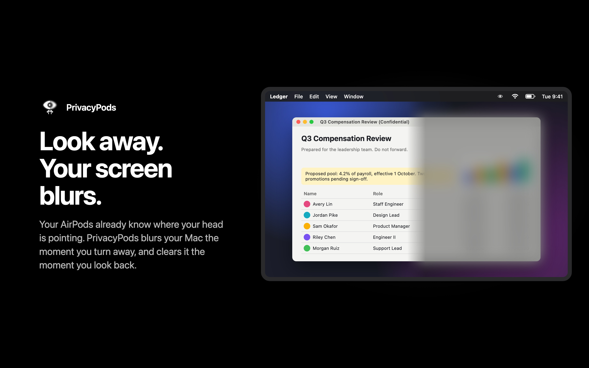
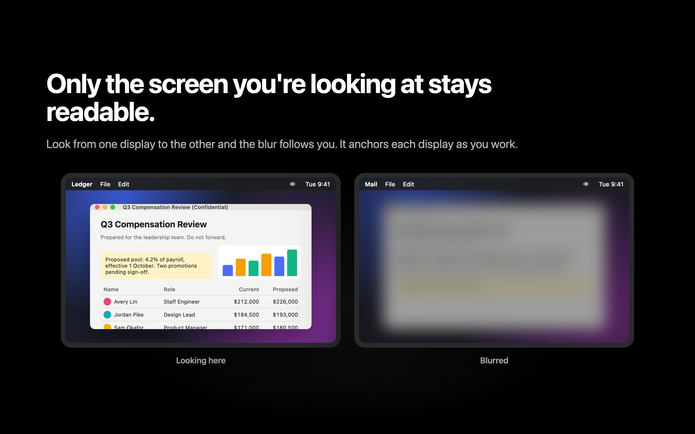
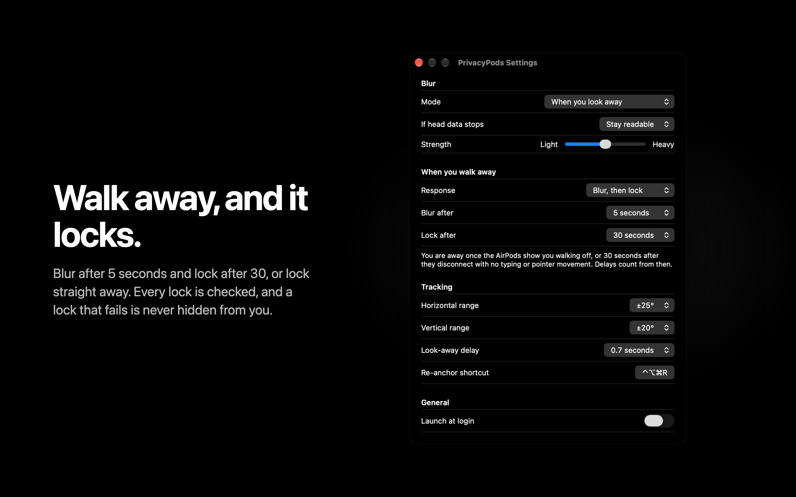
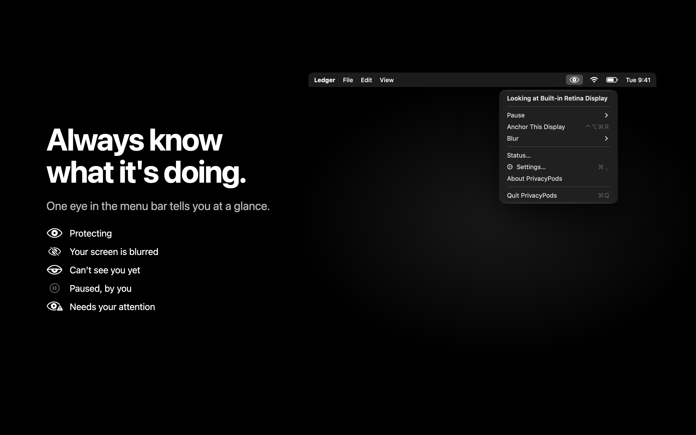
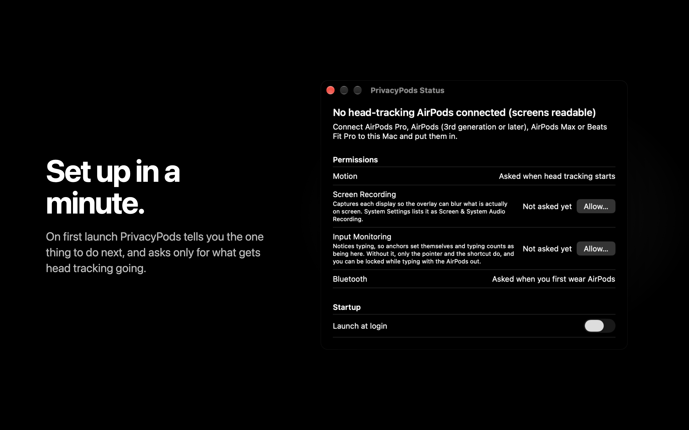
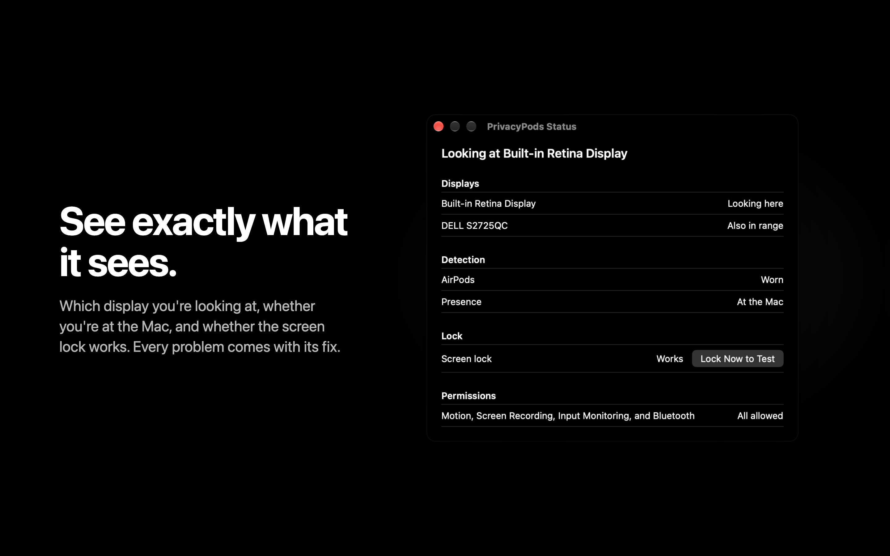
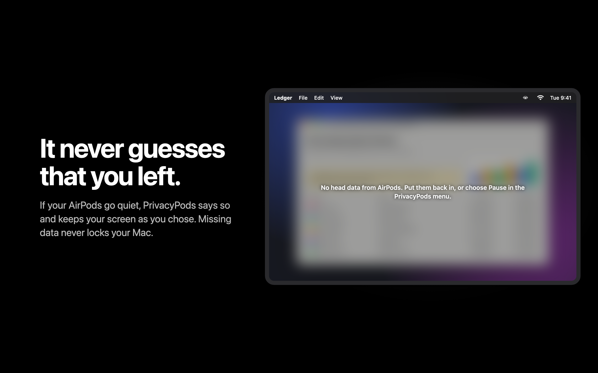

# PrivacyPods

Your AirPods already know where your head is pointing. PrivacyPods uses that to blur your
screens when you look away, and to lock the Mac when you walk off.

It lives in the menu bar and has no dock icon. Missing head data on its own never counts as you
leaving and never locks; it only blurs if you ask it to.



> Status: complete and wired, but only ever exercised on a Mac without AirPods paired. The
> head-tracking, blur and lock paths have not been watched on real hardware yet.
> `Sources/PrivacyPods/Core/README.md` is the contract, `docs/ARCHITECTURE.md` is the map.

## What it does

- Reads head orientation from your AirPods and works out which display you are looking at.
- Blurs the displays you are not looking at, or every display when you look away. Your choice.
- Notices when you stand up and leave, and locks the screen after a delay you set. If the lock
  does not take, the menu bar says so and the displays stay blurred.
- Treats a missing signal as a missing signal, never as an absent user: it can blur, if you ask
  it to, but silence alone never decides you left and never locks. You count as away once the
  AirPods show you walking off, or 30 seconds after they disconnect with no typing or pointer
  movement (taking them out and leaving looks like that).

## Screenshots

| | |
| --- | --- |
|  |  |
|  |  |
|  |  |

These are the store-size (2880×1800) images in `docs/appstore/`. The windows and menu in them
are real renders of the app; the documents behind the blur are made up.

## Supported headphones

Anything with a gyroscope that reports through `CMHeadphoneMotionManager`:

- AirPods Pro (all generations)
- AirPods (3rd generation and later)
- AirPods Max
- Beats Fit Pro

AirPods (1st and 2nd generation) and most Beats have no gyro and will not work.

## The iPhone caveat

Automatic device switching is the one thing that will quietly break this. When your iPhone
decides it wants the AirPods, the head-motion stream goes with it, and PrivacyPods sees exactly
what it sees when you take the AirPods out: silence. It will fall back to its unknown state and
stop acting.

There is no API to stop this from the Mac side. Manage it on the phone:
Settings > Bluetooth > your AirPods > Connect to This iPhone > When Last Connected to This iPhone.

## Install

Download the DMG from [Releases](https://github.com/wezzcoetzee/privacypods/releases) and drag PrivacyPods to Applications.

The app is not notarized, so the first launch shows "Apple could not verify PrivacyPods". Click Done, then open System Settings, Privacy & Security, and click Open Anyway next to PrivacyPods. Or clear the quarantine flag:

```sh
xattr -dr com.apple.quarantine /Applications/PrivacyPods.app
```

## Permissions

| Permission | Why | Without it |
| --- | --- | --- |
| Motion | Read AirPods head orientation | Nothing works. There is no fallback. |
| Screen Recording | Capture each display so the overlay has something to blur | No blurred capture. The display is still covered, but blind: dark glass with one line saying why, never the live screen. The Status window shows it, and so does the menu while a display is blind |
| Input Monitoring | Notice typing, so anchors set themselves while you work | Only pointer events get through: anchoring leans on the pointer and the re-anchor shortcut, and typing no longer resets the away timers, so you can be locked while typing with the AirPods out. Granting it mid-session takes effect within about five seconds, with no relaunch |
| Bluetooth | Check how far away the AirPods are, to back up walk-away detection | Walking away is judged from head motion and input alone. macOS asks once the AirPods are first worn, which is when proximity starts |

All four are shown in the Status window, which opens by itself on first launch (and again
whenever Motion has been refused), with live status for each one and a button through to the
right System Settings pane. Motion and Bluetooth are asked by macOS when their sensor first
starts. Until Screen Recording or Input Monitoring has been asked, the menu lists it under the
status line as a setup step once Motion is allowed (first run asks only for what gets head
tracking going); clicking it asks straight away, with Status opening behind. Once
you decline either, only the Status window shows it (and the menu, while a display is covered
blind). See `docs/PERMISSIONS.md` for the detail on
each one, including the Motion TCC trap.

Because of how TCC attributes permissions, PrivacyPods must be launched as an app bundle
(Finder, Spotlight, or `open -n PrivacyPods.app`). Running the binary directly from a terminal
makes the terminal the responsible process, and the Motion grant will not apply.

## How anchoring works

Head tracking is relative, not absolute. There is no "straight ahead" to measure against, and
the zero point drifts over minutes. Calibrating once would be wrong within the hour.

So PrivacyPods never calibrates. It anchors, continuously:

1. You type, or move the mouse, for long enough that it is clearly deliberate. Key auto-repeat
   and scroll momentum do not count; only a human at the keyboard moves the anchor.
2. PrivacyPods assumes you are looking at the display your cursor is on.
3. It records your current head angle as that display's anchor.

From then on, "which display are you looking at" is the nearest anchor within range: ±25° of
head turn and ±20° of tilt by default (Horizontal range and Vertical range in Settings). Outside
every display's range means you are looking away.
Drift gets absorbed every time you touch the keyboard, so it never accumulates.

Leaving a display is damped by the look-away delay (0.7 seconds) so a glance at a colleague does not
flicker the screen. Coming back is immediate.

If the anchor for a display is wrong, put the pointer on it, look at it, and press ⌃⌥⌘R. Anchors
are dropped on every lock and pause, so after an unlock a display you have not typed on yet is
unanchored; looking at it reads as looking away. The menu then says "Looking away, or at a display
not yet anchored", "Anchor This Display" in the menu anchors the display whose menu bar you clicked, and only the unanchored display's sheet says how to anchor it. The
Status window shows each display's anchor and whether your head is in its range right now.

## Settings

Settings are grouped by what they decide. The names below are the ones in the window.

| Section | Setting | Default | Notes |
| --- | --- | --- | --- |
| Blur | Mode | When you look away | Or displays you're not looking at, or off. Also in the menu |
| Blur | If head data stops | Stay readable | Or blur. Covers the screens while the AirPods send nothing; a sensor gap never locks |
| Blur | Strength | Middle | A slider from Light to Heavy |
| When you walk away | Response | Blur, then lock | Or lock immediately, or do nothing |
| When you walk away | Blur after, Lock after | 5 seconds, 30 seconds | Presets from 5 seconds to 10 minutes, both counted from when you leave. Lock is always later than blur |
| Tracking | Horizontal range, Vertical range | ±25°, ±20° | Presets from ±10° to ±45°. How far your head can turn or tilt from a display's anchor and still count. Widen if the app loses you at a corner |
| Tracking | Look-away delay | 0.7 seconds | How long you must look away before it counts. Presets from 0.3 to 3 seconds |
| Tracking | Re-anchor shortcut | ⌃⌥⌘R | Anchors the display under the pointer. Click it and press a new combination with ⌃ or ⌥; Reset goes back to the default |
| General | Launch at login | Off | If macOS holds the login item for approval, System Settings opens at the right pane |

Pausing is in the menu, not in Settings: Pause > For 1 Hour, or Until I Resume or Quit, then
Resume. A timed pause
resumes by itself, even across a relaunch; an open-ended one ends when PrivacyPods restarts, so
a reboot never leaves it switched off. Pause stops every sensor, clears the overlay and
cancels any away escalation, so nothing blurs and nothing locks. Locking the screen does the
same, and both drop the anchors.

If Blur is off and the walk-away response is Do nothing, the menu says "Blur and lock are both
off": the app is running but protecting nothing.

The overlay covers everything on a display except the menu bar, so the PrivacyPods menu, and its
Pause item, can always be reached, and while anything is covered the Status and Settings windows
sit above the overlay. When looking at a blurred display would not clear it (no head data, no
anchor yet), the display says why in one line.

The menu bar icon is one eye: open while protecting, slashed while the display you are looking
at (or every display) is covered, half closed while it cannot see you (no AirPods, no head data,
no anchor), and badged when something needs fixing. Paused is a dimmed pause symbol, shown even
when something needs fixing, and blur and lock both off is a dimmed circled slash: dimming always
means you chose it. Screen Recording and Input Monitoring only degrade the app, so once you have
declined either, the menu stops asking; the Status window still shows the row.

Every lock is checked. Once Motion is allowed, and until a lock has worked, the menu offers "Test
Screen Lock…" (after anything that needs fixing) and the Status window has Lock Now to Test, so
the first real lock is not also the first try. The Status window keeps the lock in one row: Not
tested yet, Works, or Failed at a time, with one Lock Now to Test button. A failure resets it to
untested. If no lock follows
within three seconds, the menu says so while you are away and keeps a "Review Failed Lock
(14:02)…" line after you return. It opens the Status window, which explains the usual cause (the
display-sleep fallback only locks when Require password is set to Immediately), links to Lock
Screen settings, has Lock Now to Test, and lets you dismiss it.

The first Status window also offers Launch at login: a privacy tool that is not running after a
restart protects nothing. Clicking a permission line in the menu asks for it
straight away, with the Status window behind the prompt.

## Building

Requires Xcode 27 (Swift 6.4) on macOS 26 or later, and
[xcodegen](https://github.com/yonaskolb/XcodeGen).

```sh
xcodegen generate
xcodebuild -project PrivacyPods.xcodeproj -scheme PrivacyPods \
  -configuration Debug -destination 'platform=macOS' build \
  CODE_SIGN_IDENTITY=- CODE_SIGNING_ALLOWED=NO
```

`PrivacyPods.xcodeproj` is generated and not checked in. Edit `project.yml` instead.

For an installable build:

```sh
./scripts/build-dmg.sh   # writes dist/PrivacyPods-<version>.dmg
```

The DMG is ad-hoc signed. TCC grants survive rebuilds because the bundle id does not change.

Pushing a `v*` tag runs the [shared macOS release workflow](https://github.com/wezzcoetzee/.github/blob/main/.github/workflows/macos-release.yml)
on `macos-26`, installs XcodeGen, and publishes the DMG to a GitHub Release with generated notes.
The tag without its leading `v` sets the app and DMG version. To build that version locally,
run `./scripts/build-dmg.sh 0.1.0`; without an argument, the script uses `project.yml`.

The app icon is generated, not drawn by hand. `scripts/icon/render.swift` composes it from SF Symbols and
`scripts/icon/make-icns.sh` writes `Supporting/AppIcon.icns`, which is checked in.

The app is not sandboxed and is not distributed through the App Store. It uses a private
lock-screen entry point and needs four TCC permissions, none of which survive the sandbox.

### Screenshots

`scripts/snapshots.sh <dir>` renders every window, menu, icon state and overlay in a fixed set
of states, against fake sensors, so UI changes can be reviewed as pictures. Windows and menus flash
on screen while it runs, and the terminal running it needs Screen Recording.

`scripts/appstore/render.sh` turns those renders into the store images in `docs/appstore/`
(layouts in `scripts/appstore/slides.html`, one slide per `#hash`). It needs Google Chrome for the
headless render, and takes an existing snapshot directory as its argument to skip re-rendering.

### Tests

Tests are Swift Testing and cover pure logic only:

```sh
xcodebuild -project PrivacyPods.xcodeproj -scheme PrivacyPods \
  -configuration Debug -destination 'platform=macOS' test \
  CODE_SIGN_IDENTITY=- CODE_SIGNING_ALLOWED=NO
```

## Known limitations

- **Yaw drifts.** Anchoring hides it as long as you keep typing. If you read for twenty minutes
  without touching anything, the anchor will be stale when you come back. The re-anchor shortcut fixes it.
- **Bluetooth proximity is coarse.** `IOBluetoothDevice.rawRSSI()` returns 0 on modern macOS, so
  the only working source is a `system_profiler` subprocess that takes about a second. Proximity
  is a slow corroborating signal, never a trigger on its own.
- **Two displays in a line are hard to tell apart.** Displays stacked vertically or angled
  similarly can fall inside each other's cones. Narrow the Horizontal or Vertical range if this bites.
- **The AirPods have to be on.** There is no camera fallback yet.
- **Screen capture costs something.** Capture runs at about 4 fps and only while a display is
  actually blurred, but it is not free.

## Future enhancements

- **Webcam face-pose fallback** via Vision, for when the AirPods are out or handed to a phone.
  This is the one that removes the hard dependency on headphones.
- **Apple Watch proximity** as a second presence signal, more reliable than Bluetooth RSSI and
  already on the user's wrist.
- **Per-app exclusions**, so a media player or a presentation never gets blurred.
- Per-display blur strength, for the display with the sensitive thing on it.
- A "meeting mode" that blurs everything but the app you are sharing.
