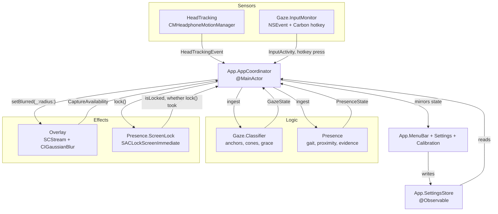
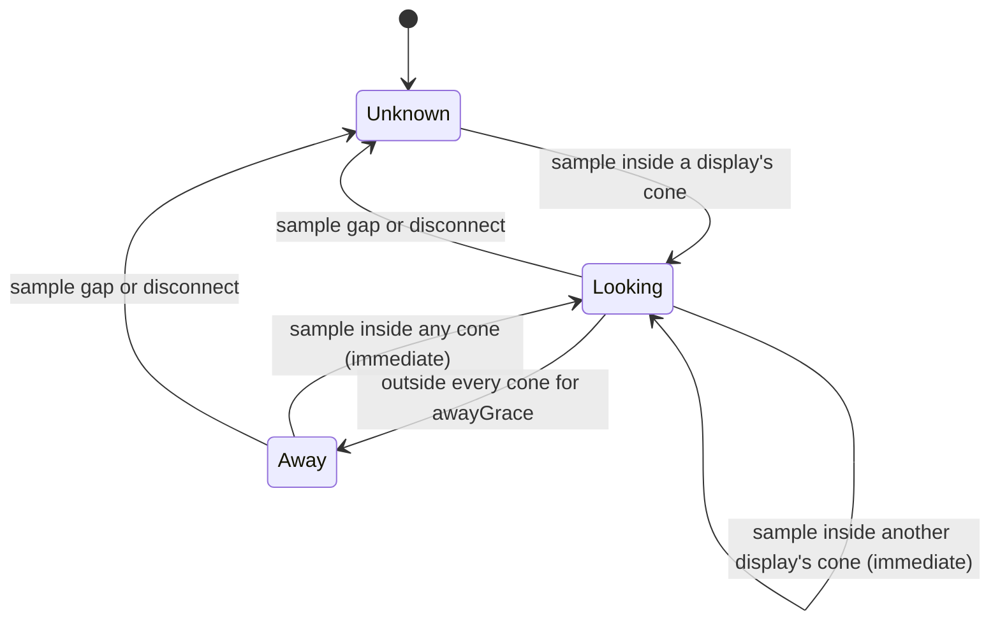
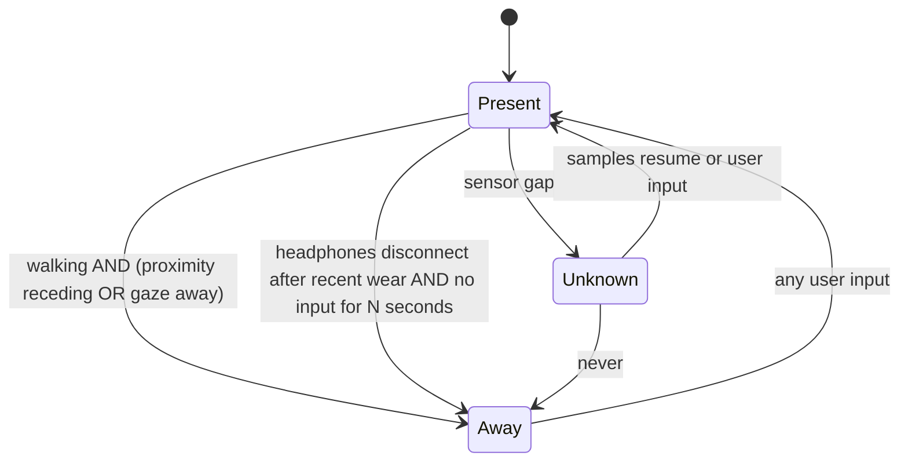

# Architecture

PrivacyPods is one macOS app target. Its directories are modules by convention: each has an
owner, each implements protocols declared in `Core`, and none of them reference each other.

## Shape

Hub and spoke. `App`'s `AppCoordinator` builds every provider (through `ProviderFactory`),
reads every `AsyncStream`, and pushes results into whoever needs them. A provider never calls
another provider. That is what keeps six people out of each other's way, and it keeps the policy
(what actually gets blurred or locked) in one readable place instead of smeared across five
modules.



Solid arrows are the only permitted couplings. Everything crossing one is a `Core` type.

One gate sits above all of it, in `AppCoordinator`: enabled and unlocked. The sensors, the
overlay and the lock all sit behind that same predicate
(`AppCoordinator.isRunGateOpen(isEnabled:isLocked:)`), so a disabled app or an already-locked
screen neither watches nor touches the screen, whatever the away policy has escalated to.
Closing the gate stops every provider, cancels the one-second escalation tick, clears the
overlay and resets the away policy, so an away session cannot carry into the next one. The
anchors go with them, because a restarted motion stream is a new reference frame anyway, and
the first burst of typing after the user returns re-anchors it.

## Modules

| Directory | Owner | Responsibility |
| --- | --- | --- |
| `Sources/PrivacyPods/Core` | architect | Shared value types and protocols. Frozen. |
| `Sources/PrivacyPods/HeadTracking` | 1 | Headphone motion, quaternion to `HeadPose`, wear-state watchdog |
| `Sources/PrivacyPods/Gaze` | 2 | Anchors, classification, grace window, input monitoring, re-anchor hotkey |
| `Sources/PrivacyPods/Overlay` | 3 | Per-display blur windows, screen capture, blur pipeline, dark scrim |
| `Sources/PrivacyPods/Presence` | 4 | Gait detection, proximity, away evidence, screen lock |
| `Sources/PrivacyPods/App` | 5 | Entry point, engine, menu bar, settings, calibration, permissions |
| `README.md`, `docs/` | 6 | User-facing documentation |

`Sources/PrivacyPods/Core/README.md` is the contract. Read it before writing anything.

## The two hard problems

**Yaw drifts, so the app anchors instead of calibrating.** Head tracking gives a relative
attitude whose zero moves over minutes, so there is no fixed "straight ahead" to measure
against. Instead, whenever the user produces sustained input, the app assumes they are looking
at the display under the cursor and records the current pose as that display's anchor.
Classification is then a nearest-anchor lookup inside an acceptance cone, and drift is
re-absorbed every time the user types. A hotkey forces the same thing on demand.

**A missing signal is not an absent user.** AirPods stop streaming when they come out of an ear,
go in the case, or get stolen by an iPhone. All of those look identical to the app, and none of
them mean the user walked away. `WearState` has no `notWorn` case for exactly this reason: the
gap states collapse into `.unknown`, `.unknown` can blur if the user opted into fail-closed, and
`.unknown` can never assert an away state or lock the screen.

## Gaze state



Leaving a display is damped by the grace window; returning is not. Glances do not flicker the
overlay, but looking back is instant.

## Presence state



The last row is the rule the whole design hangs on. A sensor gap is a sensor gap. A disconnect
only counts while the AirPods were recently on a readable head; a pair that has sat in its case
all morning says nothing about its owner when it finally drops off the radio.

Once away, `AwayPolicyRunner` escalates `.idle` to `.blur` to `.lock` on elapsed time, driven
both by presence changes and by a one-second tick, since escalation is a function of time rather
than of any further event. Both the tick and the action it produces sit behind the run gate, so
neither survives the app being disabled or the screen locking. The coordinator locks through
`ScreenLocking` (`SACLockScreenImmediate`, falling back to display sleep, which only locks when
the password delay is immediate), watches `com.apple.screenIsLocked` /
`com.apple.screenIsUnlocked`, and never blurs while locked.

`lock()` reports whether it took effect, and a lock that did not becomes the menu bar's status
line ("Could not lock the screen") until the user returns or the screen does lock. The displays
stay blurred either way, so a failed lock costs the user a warning rather than their screen.

## Permissions

| Permission | Needed by | Without it |
| --- | --- | --- |
| Motion | HeadTracking | Nothing works. There is no fallback. |
| Screen Recording | Overlay | No blur. A covered display is covered blind, and says so. |
| Input Monitoring | Gaze | Keyboard events stop arriving. Anchoring leans on the pointer and the hotkey. |

The app must be launched through LaunchServices for the Motion grant to apply to it rather than
to the terminal that started it. See `spike/README.md` and `docs/PERMISSIONS.md`.

Motion has no request call of its own: the prompt fires on the first subscription to the motion
stream, so asking means running a short-lived probe. That probe is a sensor start, which means
it belongs to the run gate, so the calibration window asks through `AppCoordinator.request(_:)`
and hides the button while tracking is already running — at which point the status is known
anyway. Input Monitoring being denied leaves the re-anchor hotkey as the only way to anchor, so
a hotkey the app could not register (usually because another app holds it) is reported in both
the calibration and the settings window rather than failing silently.

## Build

```sh
xcodegen generate
xcodebuild -project PrivacyPods.xcodeproj -scheme PrivacyPods \
  -configuration Debug -destination 'platform=macOS' build \
  CODE_SIGN_IDENTITY=- CODE_SIGNING_ALLOWED=NO
```

`PrivacyPods.xcodeproj` is generated and gitignored. Edit `project.yml`, never the project file.
Swift 6 language mode with complete strict concurrency is on for both targets.

## Testing

Swift Testing (`import Testing`), pure logic only: the gaze classifier, the presence policy
state machine, the gait detector on synthetic samples, and the coordinator's blur and status
gates (`AppCoordinator.blurredDisplays` and `statusLine`, both `nonisolated static` and pure).
No smoke tests, no tests of AppKit plumbing. Pure state machines take `now: Date` as a
parameter so they need no clock;
`Tests/PrivacyPodsTests/Support/ManualTimeSource.swift` covers the stateful drivers that do.
